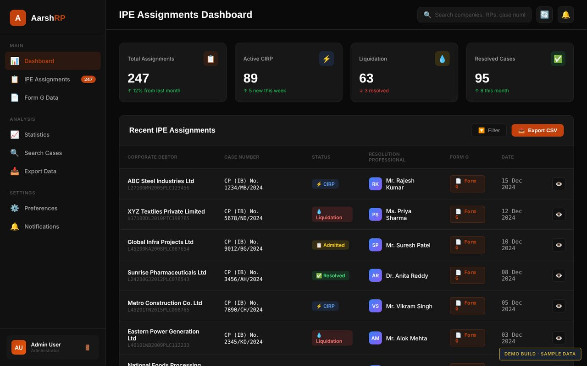
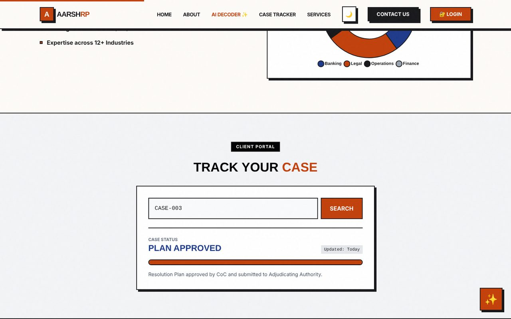
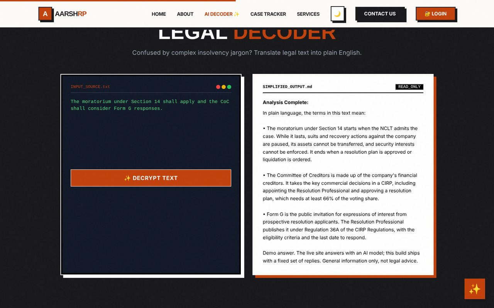
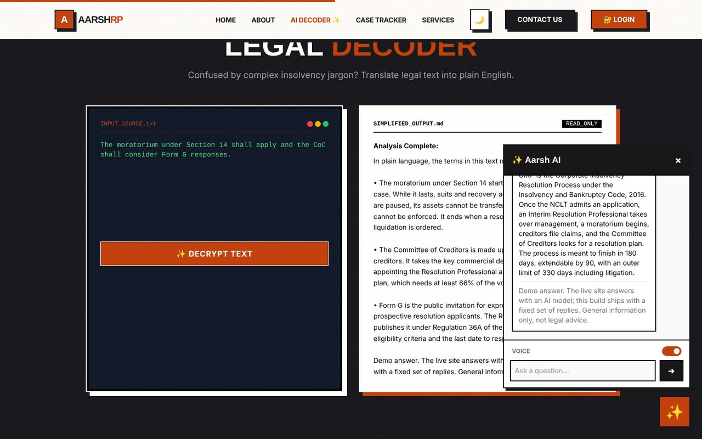
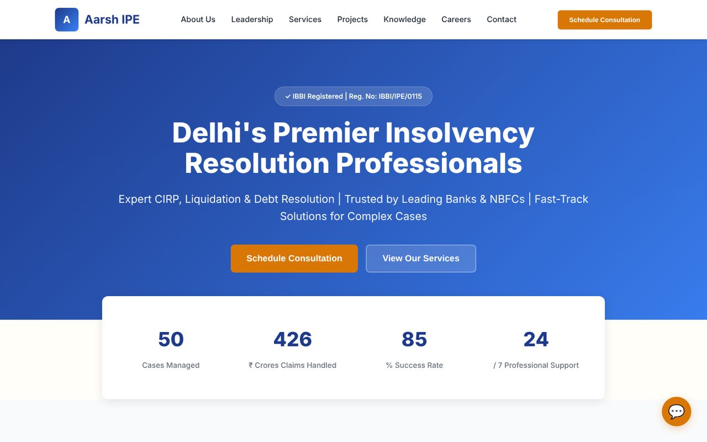

# AARSH Resolution Professionals: website and client portal demo

The first version of the website I built for AARSH Resolution Professionals, an IBBI-registered insolvency firm in Delhi. It is a static site: a landing page with three small tools, plus a demo client portal. This repository is the showcase build, so its tools answer from built-in sample data. The firm's live site has moved on from here.

The data-backed version of the portal, with a daily IBBI scraper, lives in [form-g-aarsh](https://github.com/prometheus5863/form-g-aarsh).



## What's in it

| Page | What it is |
|---|---|
| `index.html` | Landing page in a neo-brutalist style: about, case tracker, legal decoder, services, stats, contact, and a chat assistant |
| `login.html` → `dashboard.html` | Demo client portal listing IPE assignments with status, resolution professional and Form G link |
| `classic.html` | An alternative landing design in a conventional corporate style |

### The three tools on the landing page

| | |
|---|---|
|  |  |
| **Case tracker.** Enter `CASE-001`, `CASE-002` or `CASE-003` to see a status and progress bar. | **Legal decoder.** Paste a notice and get the insolvency terms in it explained in plain language. |
|  |  |
| **Assistant.** Answers questions about the Insolvency and Bankruptcy Code. | **`classic.html`**, the alternative design. |

## Demo mode

Everything here runs without a server or an API key.

- **Assistant, decoder and "magic draft".** With the placeholder key left in `script.js`, these answer from a small built-in library covering CIRP, the moratorium, the Committee of Creditors, Form G, liquidation, the NCLT and filing thresholds. Each reply is marked as a demo answer. Put a Gemini API key in `API_KEY` and the same three features call the model instead.
- **Case tracker.** Three sample cases, defined in `script.js`.
- **Portal login.** `admin@aarsh.com` / `admin123`, printed on the login page. The check happens in the browser and is **not authentication**; it only keeps the demo tidy.
- **Dashboard rows.** Sample companies and case numbers written for the demo. Their Form G buttons open IBBI's live public-announcement list.

The built-in answers are general information about the Code, not legal advice.

## Run it

It is plain HTML, CSS and JavaScript. Open `index.html`, or serve the folder:

```bash
python3 -m http.server 8000     # then open http://localhost:8000
```

## Notes for anyone taking it further

- **Do not ship an API key in `script.js`.** Anything in client-side code is public. Put the model call behind a small server route and keep the key there.
- **The portal needs a real login** (server-side sessions) before real client data goes behind it.
- **Styles.** The landing page uses Tailwind, compiled ahead of time into `tailwind.css`. After changing classes in `index.html` or `script.js`, rebuild with the command at the top of `tailwind.config.js`. Chart.js is bundled in `vendor/`. Fonts and the hero photo still load from Google Fonts and Unsplash.
- **Visitor text is escaped** before it is shown in the chat and the decoder.

## Files

```
index.html, style.css, script.js   landing page and its tools
tailwind.css, tailwind.config.js   compiled utility classes and their config
vendor/chart.umd.js                Chart.js (MIT)
login.html, dashboard.html         demo portal
classic.html                       alternative landing design
docs/screenshots/                  images used in this README
```
